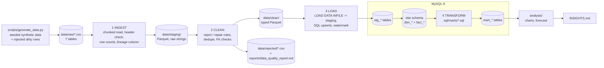
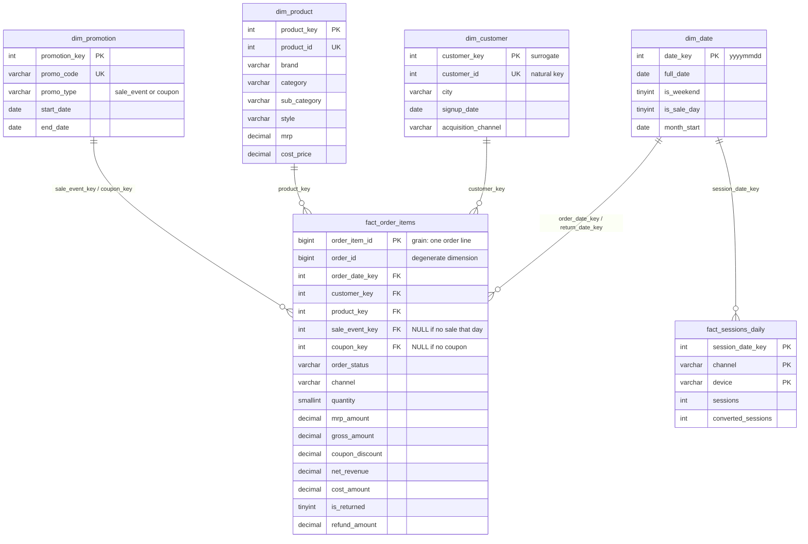
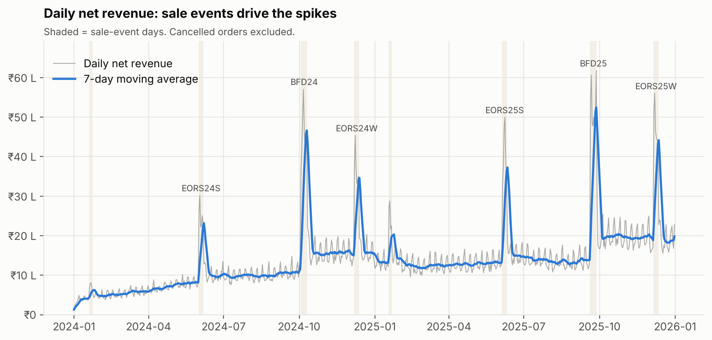
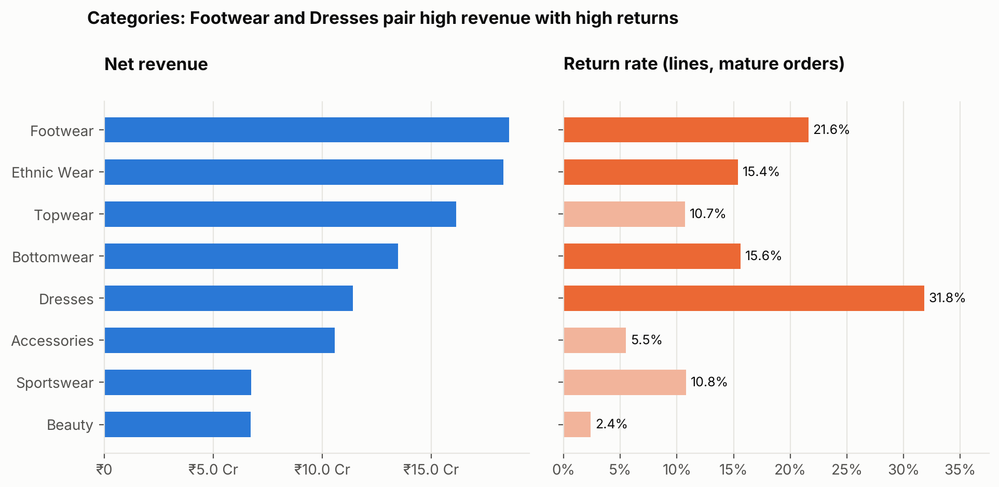

# Batch Data Pipeline: fashion e-commerce ETL into a MySQL star schema

An end-to-end **batch ETL pipeline** for a fashion e-commerce business. It ingests raw CSV
extracts, validates and cleans them with **Python/Pandas**, loads them into a **MySQL** star
schema with idempotent and incremental merges, and builds analysis-ready **SQL marts** (joins,
CTEs, window functions). These feed charts, a demand forecast and a written set of
business recommendations ([INSIGHTS.md](INSIGHTS.md)).

> **The data is synthetic.** It is produced by a seeded generator
> (`scripts/generate_data.py`) so that it contains fields public datasets lack (cost price,
> discounts, promotions, sessions, returns) and deliberate data-quality problems. Business
> patterns in it come from the generator's assumptions, not from any real company.

## Results at a glance (measured)

All numbers below come from one run of the commands in this README on a 4-vCPU / 15 GB cloud
container, MySQL 8.0 in Docker (`logs/runs.jsonl`, `reports/`).

| | |
|---|---|
| Raw rows processed (7 source tables) | **13,429,651** (incl. 1,008,000 order lines, 11.35 M sessions) |
| Rows rejected by data-quality rules | **81,810**, each written out with its reason |
| Fact table | **982,081** order lines; sessions aggregated to 15,327 day × channel × device rows |
| End-to-end runtime (`--stage all`) | **235.6 s**: ingest 22.4 s · clean 41.5 s · load 129.5 s · transform 42.2 s |
| Peak memory of the pipeline process | **743 MB** (chunked processing; was 1,254 MB before allocator tuning) |
| Re-running the full load | **0 rows affected** in every merge (idempotent), 111.3 s |
| Incremental load (watermark − 3 days) | **11.3 s** vs 111.3 s for a full re-load |
| Heavy query, before → after composite index | **1,462 ms → 491 ms (3.0×)**, verified with `EXPLAIN ANALYZE` |
| Tests | **26 passed**: 15 cleaning-rule, 4 generator, 7 SQL reconciliation checks |

## Architecture



Every stage writes its output to disk or to MySQL, so any stage can be re-run on its own.

## Quick start

Requirements: Python 3.10–3.13, Docker.

```bash
git clone https://github.com/JatinGarg-27/Batch-Data-Pipeline.git
```

```bash
cd Batch-Data-Pipeline
```

```bash
python -m venv .venv && source .venv/bin/activate
```

```bash
pip install -r requirements.txt
```

```bash
cp .env.example .env   # then change the two passwords
```

```bash
docker compose up -d   # MySQL 8 on localhost:3306, wait ~30 s for "healthy"
```

```bash
python scripts/generate_data.py          # ~1M order lines (--rows 50000 for a quick run)
```

```bash
python -m pipeline run --stage all       # ingest -> clean -> load -> transform
```

```bash
pytest                                   # unit tests + SQL sanity checks
```

```bash
python analysis/make_charts.py && python analysis/forecast.py
```

```bash
python scripts/benchmark_index.py        # optional: EXPLAIN ANALYZE before/after index
```

## How to run

```
python -m pipeline run --stage {all,ingest,clean,load,transform} [--incremental] [--lookback-days N] [--chunk-size N]
```

* `--stage` runs one stage or all of them. Each stage logs row counts and its own runtime; the
  run summary (timings, peak memory) is also appended to `logs/runs.jsonl`, and full logs go to
  `logs/pipeline.log`. Errors are reported as one clear line (e.g. *Cannot connect to MySQL... Try:
  docker compose up -d*) with the traceback in the log file.
* `--incremental` (load stage) reads the watermark (latest order date already loaded) and only
  stages orders and sessions dated on or after `watermark − lookback-days`, plus their order lines and returns.
* `python scripts/generate_data.py --rows N --seed S`: same seed and rows give identical files.
* Credentials live only in `.env` (git-ignored); `.env.example` has placeholders.

## The data

| Table | Raw rows | Key fields |
|---|---:|---|
| customers | 289,800 | city/state, signup date, acquisition channel |
| products | 20,060 | brand, category, sub-category, style, **MRP, cost price** |
| promotions | 13 | sale events (Big Fashion Days, End of Reason Sale, Republic Day) and coupons |
| sessions | 11,349,034 | date, channel, device, logged-in customer (if any) |
| orders | 625,078 | customer, session, date, status, channel, payment method, coupon |
| order_items | 1,008,000 | quantity, MRP, **selling price**, allocated coupon discount |
| returns | 137,666 | order line, return date, reason, refund |

Realism built in: sale events with 1.6–3.6× demand spikes and deeper markdowns, weekend and
monthly seasonality, festive Ethnic Wear and winter Sweatshirt seasonality, a long tail of
20,000 products (the top 20% of products make 63.4% of revenue), new vs repeat customers with
channel-dependent churn, category-specific return rates, and a cut-off where recent orders can't
have been returned yet.

Dirty data injected on purpose (and counted in `data/raw/_generation_manifest.json`): exact
duplicates, missing IDs, blank/malformed emails, `DD-MM-YYYY` vs ISO dates, impossible dates
(`2025-02-30`), future dates, inconsistent casing/whitespace (`" ethnic WEAR "`), invalid
statuses, negative MRP/prices, prices above MRP, orphan foreign keys, returns dated before
their order, refunds larger than the line value.

## Pipeline stages

**1. Ingest (`pipeline/ingest.py`).** Reads each CSV in chunks of 250k rows with
`pd.read_csv(chunksize=...)`, checks the header against the source contract
(`pipeline/schemas.py`), adds a `_source_row` line number for lineage, and lands each chunk as
Parquet. Nothing is cleaned here.

**2. Clean (`pipeline/clean.py`).** Named rules of two kinds:

* **Reject** rows that can't be trusted: missing/duplicate keys, unparseable or out-of-range
  dates, invalid status, non-positive quantity or price, price above MRP, orphan foreign keys,
  refund above line value, return before order. They are written to
  `data/rejected/<table>_rejected.csv` with the **raw** values and a `reject_reason`.
* **Repair** problems that are fixable without losing the row: casing and whitespace, `DD-MM-YYYY`
  dates, missing email → NULL, missing brand → "Unknown", missing cost price → imputed from
  the category's median cost/MRP ratio.

Orphans are split into `orphan_<fk>` (the parent never existed) and `parent_<x>_rejected` (the
parent existed but failed a rule), so a rejection in one table can be traced to its root cause.
Duplicates and foreign keys are checked **across chunks** using NumPy bitmaps indexed by ID
(1 byte per key) instead of Python sets.

**3. Load (`pipeline/load.py`, `sql/schema/`, `sql/load/`).** Bulk-loads the clean Parquet into
`stg_*` tables with `LOAD DATA LOCAL INFILE` (`'' → NULL` via `NULLIF`), then merges into the star
schema with `INSERT ... ON DUPLICATE KEY UPDATE`, all in **one transaction**. A check fails the load
if any staged order line did not reach the fact table. The `etl_watermark` table enables
`--incremental`, and `etl_load_log` keeps an audit row per run.

**4. Transform (`pipeline/transform.py`, `sql/marts/`).** Runs the mart SQL files in order. Each
DROPs and re-CREATEs its tables, so re-running gives the same result. All SQL lives in `.sql` files, with comments
explaining every non-obvious construct.

## Schema



Design choices worth knowing:
* **Surrogate keys** in dimensions (with the source ID kept as a unique natural key), SCD type 1.
* **Returns are folded into the fact row**, because an order line is returned at most once (same grain).
* **Sessions are stored as a daily snapshot** (day × channel × device). Conversion only needs
  counts; 11.3 M visit rows stay in staging for the batch only.
* **`dim_promotion` is a role-playing dimension**: the fact table links to it twice, once for the
  sale event running that day (a date-range join) and once for the coupon on the order.
* Indexes: FK indexes, `(customer_key, order_date_key)` for customer-history queries,
  `(order_id)` for order-level rollups, `(category, sub_category)` and `(brand)` on products.

### Marts

| Table | What it answers | SQL techniques |
|---|---|---|
| `mart_daily_sales` / `_weekly_` / `_monthly_` | revenue, gross margin, margin %, discount %, AOV, orders per customer, WoW / MoM / YoY | LEFT JOIN from dim_date (no gaps), `AVG() OVER` 7-day moving average, `LAG` (YoY guarded against missing months) |
| `mart_conversion_daily_channel` | orders ÷ sessions by day & channel | CTEs, rolling 7-day **ratio of sums** |
| `int_customer_month`, `mart_new_vs_returning`, `mart_cohort_retention` | new vs returning, monthly cohort retention | `MIN() OVER (PARTITION BY)`, `TIMESTAMPDIFF`, `FIRST_VALUE` over a `GROUP BY` |
| `mart_customer_acquisition` | new customers by month & channel, 90-day repeat rate | `ROW_NUMBER`, conditional pivot, completeness flag |
| `mart_product_performance`, `mart_brand_rank_in_category` | top categories, sub-categories, brands, styles; contribution %; return rate | `RANK`, `DENSE_RANK`, `SUM() OVER` for contribution and Pareto, `UNION ALL` |
| `mart_sale_event_effectiveness`, `mart_sale_vs_regular_days`, `mart_coupon_performance` | revenue, discount cost and margin during vs outside promotions; uplift vs a 28-day baseline | range joins, CTEs, order-level rollup |

## Data-quality report (excerpt)

From `reports/data_quality_report.md`, generated by every clean run:

| Table | Rows in | Rows rejected | Rows out | Rejected % |
|---|---:|---:|---:|---:|
| customers | 289,800 | 1,299 | 288,501 | 0.45% |
| products | 20,060 | 120 | 19,940 | 0.60% |
| sessions | 11,349,034 | 39,603 | 11,309,431 | 0.35% |
| orders | 625,078 | 10,564 | 614,514 | 1.69% |
| order_items | 1,008,000 | 25,919 | 982,081 | 2.57% |
| returns | 137,666 | 4,304 | 133,362 | 3.13% |

Rejections per rule include, for example, order_items: `duplicate_order_item_id`,
`parent_order_rejected`, `orphan_order_id`, `orphan_product_id`, `non_positive_quantity`,
`missing_selling_price`, `selling_price_above_mrp`. The report also lists every repair and
compares the counts with what the generator injected.

## Performance notes (all measured)

* **End-to-end:** 235.6 s for 13.4 M raw rows (generation, 66 s, is separate). Load is the
  largest stage. Within it, bulk-loading 11.3 M sessions into staging takes 56 s and the fact
  upsert takes 46 s.
* **Index benchmark** (`reports/index_benchmark.md`): "new customers per first-order month"
  needs every customer's first order date. With only the FK index on `customer_key`, MySQL
  read all 982,081 rows (1,462 ms median). With the composite index `(customer_key,
  order_date_key)`, `EXPLAIN ANALYZE` shows a *covering index skip scan for grouping*: it reads
  one index entry per customer (248,579) and the median drops to **491 ms (3.0×)**. The index takes 1.2 s to build.
* **Load tuning during development** (on the previous data version): the first working load took
  382 s. Clustering `stg_sessions` on `(session_date, channel, device, session_id)` let the daily
  aggregation read rows already in group order instead of building a temp table (45 s → 4 s in isolation).
  Moving sessions to a daily snapshot fact, disabling the binary log, which is only needed for
  replication, and enlarging the redo log brought the full load to 140 s.
* **Memory:** profiling showed the clean stage's resident memory growing across chunks although
  each chunk was released. The cause was allocator caching, not data. Switching Arrow to the
  system allocator plus `malloc_trim` between chunks cut the peak from 1,254 MB to 743 MB, and
  Arrow-backed strings cut clean time from 58.5 s to 41.5 s.

## Key insights

Full write-up with numbers and actions: **[INSIGHTS.md](INSIGHTS.md)**. Headlines:

1. Sale days are 6.6% of days but 17.8% of revenue, and only 12.1% of gross margin. Margin
   falls from 42.1% to 26.6% on sale days.
2. Dresses return 31.8% of lines, cutting margin from 38.8% to 26.8% after returns. In size-based
   categories ~65% of returns cite size.
3. Social is 32.7% of sessions but converts at 2.46% (direct: 10.25%), and only 29.4% of
   social-acquired customers re-order within 90 days (direct: 51.7%).
4. Month-1 retention averages 22.5%. Returning customers grew to 58.2% of monthly revenue.
5. A 30-day forecast with a sale-calendar feature reaches **7.9% MAPE** on Footwear vs 20.7% for a
   seasonal-naive baseline. It does worse than the baseline on Topwear (34.7% vs 20.8%), and the
   write-up explains why.




All charts: `analysis/charts/` (daily revenue, monthly revenue & margin, channel quality,
cohort heatmap, category returns, brand Pareto, sale events, new vs returning, forecast).

## Tests

```bash
pytest -v
```

* `tests/test_clean_rules.py`: every cleaning rule on small hand-made frames (no DB needed),
  including cross-chunk dedupe and orphan vs parent-rejected attribution.
* `tests/test_generator.py`: same seed gives identical data, `--rows` is honoured, keys are consistent.
* `tests/test_sql_sanity.py`: reconciliation against MySQL: mart revenue = fact revenue;
  daily = weekly = monthly; category revenue sums to the total and contributions to 100%;
  conversion ≤ 100% and sessions reconcile; every cohort starts at 100%; new customers are
  counted exactly once. These are skipped automatically if the warehouse isn't reachable.

## Project structure

```
pipeline/            __main__ (CLI), config, ingest, clean, quality (DQ report, ID bitmaps), load, transform, db
sql/schema/          01_staging.sql, 02_star.sql
sql/load/            dimension and fact upserts, watermark
sql/marts/           11 mart files (+ README with shared metric definitions)
scripts/             generate_data.py, benchmark_index.py
analysis/            make_charts.py, forecast.py, charts/, outputs/
reports/             data_quality_report.md/.json, index_benchmark.md, forecast_results.md
tests/               pytest suite
docker-compose.yml   MySQL 8 with settings for bulk loading
```

## Limitations and next steps

* Product cost is SCD type 1 (current cost), so historical margin uses today's cost. A type-2
  `dim_product` would fix that.
* Incremental mode re-merges a fixed lookback window. Changes to orders older than that (e.g. a
  very late status change) would need a change-data-capture feed.
* Deleting a row in the source does not delete it from the warehouse (upserts only).
* The sale-event baseline ignores the pre-sale dip, so uplift is an upper bound.
* Orchestration is a single CLI. Each stage is a function with on-disk inputs and outputs, so it
  maps directly onto Airflow tasks.
